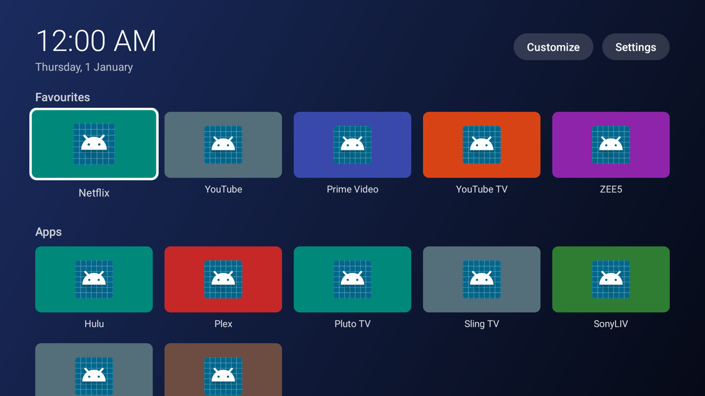

# TV Home – tez aur saaf TV launcher

Google TV / Android TV box (jaise **onn 4K Pro**) ke liye apni home screen.



*(Ye preview test apps se bana hai, isliye icons generic hain. TV par har app ka asli logo/banner dikhega.)*

## Kya milta hai

- **Tez:** app sirf ~60 KB ki hai. Na ads, na "recommended" rows, na internet use. Turant khulti hai.
- **Upar ghadi aur date**, phir **Favourites**, phir baaki **Apps**.
- **Faltu apps chhupao:** *Customize → Choose apps to show* mein jo nahi chahiye uska tick hata do.
- Kisi bhi app par **OK dabaye rakho** (hold) to ye menu khulta hai:
  - Add to Favourites / Remove from Favourites
  - Move left / Move right (favourites ka order)
  - Hide from home screen
  - App info
  - Uninstall
- **Background colour:** *Customize → Change background* mein 5 rang hain.
- **Settings** button seedha TV ki settings kholta hai (Wi-Fi, display, sound wagairah).
- Remote ka **Back** dabane se launcher band nahi hota, bas upar aa jaata hai.
- Remote ka **Home** button bhi TV Home khol sakta hai (neeche step 6 dekho).

## TV par install kaise karein (onn 4K Pro / Google TV)

Ek baar karna hai, lagbhag 10 minute.

**1. Downloader app daalo**
Box par **Play Store** kholo → **"Downloader"** search karo (AFTVnews wala, orange icon) → Install.

**2. Developer mode on karo**
**Settings → System → About** → neeche **"Android TV OS build"** tak jao → us par **OK 7 baar** dabao.
"You are now a developer" aayega.

**3. Downloader ko app install karne ki permission do**
**Settings → Apps → Security & restrictions → Unknown sources** → **Downloader** ko **On** karo.

**4. TV Home download karo**
Downloader kholo. URL wale box mein ye likho aur **Go** dabao:

```
https://github.com/cedarfalls-ux/house/raw/claude/modest-hypatia-b75txu/tv-launcher/TVHome.apk
```

> Tip: phone par **Google TV app** kholo aur uske keyboard se type karo. Remote se type karne se kaafi aasan hai.

Download ke baad **Install** dabao, phir **Done**. Downloader file delete karne ka poochhe to **Delete** kar do.

**5. TV Home kholo**
Google TV ki home screen par **Apps** mein **TV Home** milega. Use kholo.

**6. Remote ka Home button TV Home par lagao**
TV Home mein **Customize → Remote Home button → Open settings** dabao.
Accessibility list mein **"TV Home – Home button"** chuno → **On** karo → **OK/Allow**.
Ab remote ka Home dabaoge to TV Home khulega. Pehle ek pal ke liye Google wali screen jhalak sakti hai, ye normal hai.

> Agar wahan **"Restricted setting"** likha aaye ya option grey ho:
> **Settings → Apps → TV Home** kholo. Agar wahan **"Allow restricted settings"** dikhe to use dabao aur step 6 phir se karo.
> Na mile to screen ki photo bhejo. Neeche wala *Advanced* tarika kaam karega.

**7. Apni pasand set karo**
- **Customize → Choose apps to show:** faltu apps ka tick hatao → **Done**.
- Netflix, YouTube jaisi apps par **OK hold** karo → **Add to Favourites**.
- **Move left / Move right** se favourites ka order lagao.

Band karna ho to *Customize → Remote Home button → Turn off*, ya TV Home ko uninstall kar do. Google wali home screen waise hi wapas aa jaati hai.

## Advanced (sirf zaroorat ho to, computer chahiye)

Ye tab kaam aata hai jab step 6 ka accessibility option band ho, ya Home button par Google screen bilkul nahi dikhni chahiye.
Iske liye computer par `adb` chahiye, aur TV par **Settings → System → Developer options → USB debugging** on ho.

```
adb connect <TV-ka-IP-address>
# Option A: "Restricted setting" hatao, phir step 6 dobara karo
adb shell appops set com.cedarfalls.tvhome ACCESS_RESTRICTED_SETTINGS allow
# Option B: Google ki home screen band karo, taaki TV Home hi home screen bane
adb shell pm disable-user --user 0 com.google.android.apps.tv.launcherx
adb shell pm disable-user --user 0 com.google.android.tungsten.setupwraith
```

Option B ko wapas lene ke liye:

```
adb shell pm enable com.google.android.apps.tv.launcherx
adb shell pm enable com.google.android.tungsten.setupwraith
```

---

## Developers ke liye

Plain Java hai, sirf Android framework use hota hai (koi AndroidX ya library nahi). Isliye APK chhoti hai aur jaldi chalti hai.

| File | Kaam |
|---|---|
| `app/src/main/java/.../HomeActivity.java` | Home screen, app menu, Customize menu |
| `app/src/main/java/.../AppStore.java` | Installed apps background thread par dhundta hai aur memory mein rakhta hai |
| `app/src/main/java/.../HomeButtonService.java` | Google ki home screen dikhte hi TV Home wapas laata hai (accessibility service, sirf launcher packages ke events) |
| `app/src/main/java/.../Prefs.java` | Favourites, hidden apps, background, Home button setting |
| `build.sh` | Android Studio ke bina APK banata hai (Ubuntu packages se) |
| `tests/` | Robolectric tests (Android 14 framework par) + screenshot |

**Build:**

```
sudo apt-get install aapt apksigner dalvik-exchange zipalign android-sdk-platform-23
./build.sh            # -> TVHome.apk
```

Signing key `tvhome.keystore` pehle build par banti hai aur commit nahi hoti. Android update tabhi install karta hai jab APK same key se sign ho. Nayi key se bani APK ke liye pehle purani TV Home uninstall karni padegi.

**Tests:**

```
tests/run-tests.sh    # APK build + androidx.test classes build + Robolectric tests
```

`ScreenshotTest` home screen ko TV size (1920×1080) par `tests/target/home-screen.png` mein draw karta hai.
